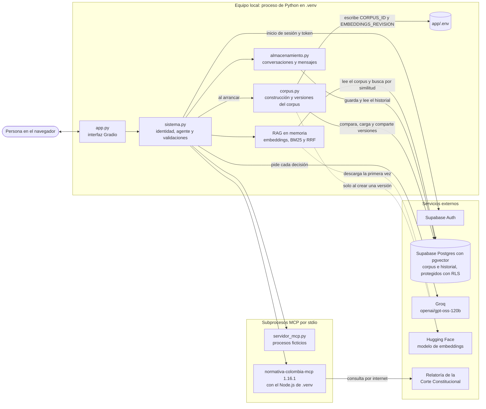

# Asistente normativo

El asistente normativo es una aplicación web, construida con Gradio, que acompaña a las personas que trabajan en juzgados de Colombia en sus consultas del día a día. Detrás de la interfaz hay un agente que se apoya en un modelo generativo de Groq y que, según lo que se le pregunte, consulta tres fuentes distintas. La primera es un corpus documental con los artículos 1 a 94 de la Constitución Política. La segunda es un registro de procesos judiciales ficticios, al que se accede mediante un servidor MCP propio. La tercera es la jurisprudencia de la Corte Constitucional, disponible a través de un servidor MCP externo. Además, cada persona inicia sesión con su propia cuenta y conserva su historial de conversaciones en Supabase.

**Entrega:** final (corte 3).\
**Autor:** Sebastián Cruz Cardona.\
**Código:** 240220222010.\
**Programa:** Ingeniería de Software.\
**Institución:** Institución Universitaria EAM.

## Contenido

1. [Problema, usuarios y objetivo](#1-problema-usuarios-y-objetivo)
2. [Alcance](#2-alcance)
3. [Arquitectura](#3-arquitectura)
4. [Recorrido de una pregunta](#4-recorrido-de-una-pregunta)
5. [Responsabilidades de los módulos](#5-responsabilidades-de-los-módulos)
6. [Corpus, embeddings y recuperación](#6-corpus-embeddings-y-recuperación)
7. [Servidores MCP](#7-servidores-mcp)
8. [Supabase: autenticación, tablas, RLS e historial](#8-supabase-autenticación-tablas-rls-e-historial)
9. [Requisitos y versiones](#9-requisitos-y-versiones)
10. [Instalación desde un clon limpio](#10-instalación-desde-un-clon-limpio)
11. [Variables de entorno](#11-variables-de-entorno)
12. [Ejecución](#12-ejecución)
13. [Pruebas del sistema](#13-pruebas-del-sistema)
14. [Despliegue](#14-despliegue)
15. [Problemas frecuentes](#15-problemas-frecuentes)
16. [Limitaciones](#16-limitaciones)
17. [Seguridad y privacidad](#17-seguridad-y-privacidad)
18. [Estructura del repositorio y documentación](#18-estructura-del-repositorio-y-documentación)

## 1. Problema, usuarios y objetivo

Responder bien una consulta jurídica exige más que conocer la norma. Primero hay que entender qué está pidiendo la persona, luego identificar si falta información para atenderla y, sobre todo, evitar afirmaciones que no tengan respaldo. En un juzgado, además, las preguntas suelen mezclar fuentes, porque alguien puede necesitar en la misma conversación un artículo constitucional, el estado de un proceso y algunas sentencias relacionadas. Por eso las respuestas tienen que poder contrastarse con la fuente de la que salieron.

El asistente está pensado para abogados y personal de juzgados en Colombia, y cada uno de ellos trabaja con su propia cuenta.

El objetivo de esta entrega final es reunir en una sola aplicación web el trabajo de los cortes anteriores, de manera que ya no sea necesario ejecutar celdas de un notebook. Así, la aplicación integra los contratos, la validación y la consulta de procesos ficticios del corte 1, el RAG con Supabase y la recuperación híbrida del corte 2, y el agente con herramientas MCP y la persistencia de las conversaciones en Supabase del tercer corte.

## 2. Alcance

### Lo que está implementado

- Inicio de sesión con Supabase Auth, en el que cada solicitud usa un cliente creado con el token del propio usuario.
- Varias conversaciones por usuario, que se guardan en Supabase y se pueden recuperar después de cerrar sesión o de reiniciar la aplicación.
- Un agente que en cada paso elige una de siete acciones (`buscar_documentos`, `consultar_estado_proceso`, `buscar_jurisprudencia`, `linea_jurisprudencial`, `responder`, `aclarar` o `rechazar`) y cuya decisión se valida con un contrato estricto de Pydantic llamado `Decision`.
- Un RAG híbrido que combina la búsqueda semántica en Supabase con la búsqueda léxica BM25 y fusiona ambos resultados con Reciprocal Rank Fusion (RRF).
- Un servidor MCP propio, de solo lectura, para consultar procesos ficticios.
- Un servidor MCP externo (`normativa-colombia-mcp`) del que solo se habilitan dos herramientas de la Corte Constitucional.
- Citas verificadas, en las que `[F1]` o `[F2]` señalan fragmentos del corpus y `[T1]` señala el resultado del MCP propio. Si una cita no coincide con el texto o con las fuentes consultadas, el sistema la rechaza.
- Controles sobre el recorrido del agente, que limitan las operaciones, las decisiones, el tiempo y el contexto, y que además detectan cuándo el agente intenta repetir una consulta.
- Una interfaz con un panel lateral donde se ven el estado del turno, las fuentes citadas, las herramientas utilizadas (con sus argumentos y su resultado) y la traza completa del recorrido.
- Una construcción reproducible del corpus desde el código en `app/corpus.py`, que genera una versión nueva automáticamente cuando cambia el texto, lo que permite modificar y aumentar el corpus cuando se requiera.

### Lo que queda fuera

- Los expedientes reales, ya que es un ejercicio académico y no se tiene acceso a una base de datos real de procesos de un juzgado.
- La creación, modificación o eliminación de procesos.
- La modificación de documentos del corpus o eliminación de conversaciones por parte de los usuarios en tiempo de ejecución de la aplicación.
- El registro de nuevas cuentas desde la aplicación, porque las cuentas se crean manualmente en Supabase.
- La jurisprudencia de cortes distintas a la Corte Constitucional, los autos y la verificación de la vigencia de una sentencia.
- La asesoría jurídica definitiva, puesto que toda respuesta necesita revisión humana.
- El despliegue en un servicio de alojamiento, porque esta entrega se ejecuta en local (ver la sección 14).

## 3. Arquitectura



El diagrama distingue tres zonas. En el equipo local corre un único proceso de Python, que reúne la interfaz, la coordinación del agente, el RAG, el historial y la construcción del corpus. El modelo de embeddings y el índice BM25 también viven dentro de ese proceso, de modo que la búsqueda léxica y la fusión con RRF no salen del equipo. Los dos servidores MCP, en cambio, corren como subprocesos que `sistema.py` inicia y con los que se comunica por stdio. El MCP propio usa el mismo Python de `.venv`, mientras que el externo usa el Node.js instalado en `.venv` y es el único que sale a internet, para consultar la relatoría de la Corte Constitucional. Por último, están los servicios externos, es decir, Supabase para la identidad y los datos, Groq para las decisiones del agente y Hugging Face para descargar el modelo de embeddings.

También conviene notar con qué identidad se habla con Supabase. El RAG y `almacenamiento.py` siempre usan el token de la persona que inició sesión, así que todo lo que leen o escriben pasa por sus políticas RLS. `corpus.py` es la excepción, porque trabaja con la cuenta dueña del corpus (`CORPUS_EMAIL`), que es la única autorizada para cargar y compartir versiones nuevas. Groq, por su parte, solo recibe la pregunta, la memoria de la conversación, los catálogos de herramientas y los resultados del turno, nunca las credenciales.

Antes de atender la primera pregunta, la aplicación se prepara por completo con `sistema.preparar()`. En ese momento sincroniza el corpus, lee la configuración y crea el cliente de Groq. Después carga el modelo de embeddings y, por último, instala Node.js y el MCP externo si todavía no están, y descubre las herramientas de los dos servidores MCP.

El corpus y el índice BM25, en cambio, se cargan en memoria cuando el primer usuario inicia sesión. Esto se debe a que las políticas RLS exigen un usuario autenticado para leerlos. Esa carga ocurre una sola vez y luego la comparten todas las sesiones.

## 4. Recorrido de una pregunta

Cuando alguien escribe en el chat, `app.py` muestra la pregunta de inmediato y bloquea la entrada, para que no se envíe dos veces. A partir de ahí, `sistema.atender_mensaje()` se encarga del resto del recorrido.

En primer lugar, valida el token del usuario con Supabase Auth y lo renueva si ya venció. Luego, si se trata de la primera pregunta de una conversación, la crea. Si no, carga sus mensajes, no sin antes comprobar en `almacenamiento.py` que la conversación pertenezca a ese usuario. Con esos mensajes se arma la memoria del agente, que corresponde a los últimos cuatro turnos completados de la conversación, es decir, los que terminaron en `RESPONDER`, `ACLARAR` o `RECHAZAR`.

Con esto, `sistema.atender()` le pide a Groq una decisión en formato JSON y la valida con `validar_decision`. Si la decisión es usar una herramienta, `controlar_operacion` revisa que no se repita una consulta idéntica ni se supere el máximo permitido. Solo entonces la ejecuta, y el agente vuelve a decidir con el resultado en la mano. Para que el recorrido no se extienda sin control, cada turno admite como máximo dos operaciones, tres decisiones, 90 segundos y 24 000 caracteres de contexto.

Una vez el agente termina, `almacenamiento.guardar_turno()` guarda la pregunta y la respuesta en una sola inserción, junto con el estado, las citas, las fuentes citadas y la traza. La interfaz solo da por guardado un turno que efectivamente quedó en Supabase. Finalmente, el chat muestra la respuesta y el panel lateral derecho muestra su estado, sus fuentes, sus herramientas y su recorrido. Si más adelante se hace clic sobre un mensaje anterior, el panel vuelve a mostrar esos mismos datos.

Lo normal es que un turno termine en `RESPONDER`, `ACLARAR` o `RECHAZAR`. Sin embargo, también puede terminar en un estado de error o de detención, como `ERROR_VALIDACION`, `ERROR_TECNICO`, `ERROR_PERMISO`, `LIMITE_TIEMPO`, `LIMITE_OPERACIONES`, `REPETICION_SIN_AVANCE`, `LIMITE_CONTEXTO` o `LIMITE_DECISIONES`. En esos casos la interfaz tiene cuidado de no presentar un error técnico como si fuera falta de evidencia. En [`preguntas-pruebas-manuales.md`](preguntas-pruebas-manuales.md) se explica cuándo aparece cada uno de estos estados.

## 5. Responsabilidades de los módulos

| Archivo | Responsabilidad |
|---|---|
| [`app/app.py`](app/app.py) | Presenta la interfaz de Gradio, con el inicio y cierre de sesión, la lista de conversaciones, el chat y el panel lateral. En `gr.State` guarda solo datos serializables de la sesión y no contiene lógica del agente. |
| [`app/sistema.py`](app/sistema.py) | Coordina el recorrido completo. Aquí están la configuración, la identidad por usuario, el RAG, los clientes MCP, el contrato `Decision`, las validaciones y los límites, además del agente (`atender`) y del recorrido que se inicia desde la interfaz (`atender_mensaje`). Proviene del notebook `notebooks/asistente_normativo_RAG_agente_MCP.ipynb`. |
| [`app/almacenamiento.py`](app/almacenamiento.py) | Crea y lista conversaciones, carga sus mensajes y guarda cada turno en Supabase, siempre después de comprobar el propietario. También arma la memoria del agente. |
| [`app/corpus.py`](app/corpus.py) | Construye el corpus, desde los textos hasta su carga en Supabase, pasando por la limpieza, la fragmentación, los embeddings y la validación. Además, crea una versión nueva cuando cambia el texto. Proviene del prototipo del segundo corte `notebooks/prototipo_asistente_normativo_corte2.ipynb`. |
| [`app/servidor_mcp.py`](app/servidor_mcp.py) | Es el servidor MCP propio, con la herramienta `consultar_estado_proceso` sobre diez procesos ficticios en memoria. |
| [`app/supabase/`](app/supabase/) | Reúne el script SQL de la clase 8 y las migraciones del historial y del corpus compartido. |
| [`app/pruebas/`](app/pruebas/) | Contiene las pruebas con pytest de los controles, el historial y RLS, el corpus y el recorrido con el modelo. |

## 6. Corpus, embeddings y recuperación

### El corpus

El corpus contiene un solo documento, `constitucion_politica.md`, con los artículos 1 a 94 de la Constitución Política de Colombia. Su texto vive en el diccionario `FUENTES` de [`app/corpus.py`](app/corpus.py), de modo que cualquier cambio en el corpus pasa por el código y queda registrado en Git.

Para fragmentarlo se usan ventanas de 95 tokens, contando el encabezado "documento / artículo", con un solapamiento de 17 tokens entre ventanas consecutivas, como se definió desde el entregable del segundo corte. Conviene tener en cuenta que cada artículo debe llevar un título de nivel 2 (`## Artículo N`), porque la fragmentación solo abre una sección nueva en ese nivel. La versión vigente es `asistente_normativo-7d27acce156e`, con 94 secciones y 155 fragmentos en la tabla `clase08_fragmentos`.

### Los embeddings

Los embeddings se calculan con `sentence-transformers/paraphrase-multilingual-MiniLM-L12-v2`, cuya revisión exacta queda fijada en la variable `EMBEDDINGS_REVISION`. Cada vector tiene 384 dimensiones, está normalizado y se compara con similitud coseno. Todo este cálculo se hace en CPU.

### La recuperación

La función `buscar_documentos` combina dos búsquedas. Por un lado, la búsqueda semántica en Supabase, mediante la función `buscar_fragmentos_compartidos`, trae diez candidatos. Por otro, BM25 (`rank-bm25`) trae otros diez a partir del corpus cargado en memoria. Después, RRF fusiona ambos rankings con una constante de 60, y de esa fusión se conservan los tres mejores fragmentos.

Esta estrategia es el resultado de la evaluación de la clase 9, en la que se compararon tres opciones. La opción A usaba solo búsqueda semántica, la B combinaba la búsqueda híbrida con RRF y la C añadía un reranker a la búsqueda híbrida. B y C obtuvieron las mismas métricas de recuperación (Precision@3, Recall@3, Hit@3 y RR) en los cuatro casos de desarrollo y en los dos de reserva. A, en cambio, quedó por debajo en los casos de desarrollo y solo las igualó en los de reserva. Durante el desarrollo llegó a registrarse C por su menor latencia de generación. Al final, sin embargo, se eligió B, porque logra la misma calidad de recuperación sin el costo del reranker, que en esa evaluación llevó el tiempo promedio de recuperación de 454 ms a 1505 ms. Todo el detalle está en [`evidencias/Clase_09_Evidencia_Evaluacion_RAG.json`](evidencias/Clase_09_Evidencia_Evaluacion_RAG.json).

### Cómo se recupera o se actualiza el corpus

Para tener el corpus no hace falta ejecutar ningún notebook ni subir archivos. Cada vez que la aplicación arranca, `sistema.sincronizar_corpus()` inicia sesión con la cuenta dueña del corpus (`CORPUS_EMAIL`) y compara los textos de `FUENTES` con lo que hay guardado en Supabase.

Si los textos no cambiaron, la aplicación no modifica nada y ni siquiera carga el modelo. Si cambiaron, o si se trata de una instalación nueva sin corpus, construye una versión nueva con otro `CORPUS_ID`, la carga en Supabase, la comparte con los demás usuarios y escribe `CORPUS_ID` y `EMBEDDINGS_REVISION` en `app/.env`. Las versiones anteriores no se borran. Por lo tanto, para cambiar el corpus basta con editar los textos de `FUENTES` y reiniciar la aplicación.

## 7. Servidores MCP

| | MCP propio | MCP externo |
|---|---|---|
| Procedencia | [`app/servidor_mcp.py`](app/servidor_mcp.py), desarrollado en el notebook [`asistente_normativo_RAG_agente_MCP.ipynb`](notebooks/asistente_normativo_RAG_agente_MCP.ipynb) | Paquete npm `normativa-colombia-mcp`, en la versión fija `1.16.1` |
| Transporte | stdio, ejecutado con el Python de `.venv` | stdio, ejecutado con el Node.js de `.venv` (`nodejs-wheel`) |
| Herramientas habilitadas | `consultar_estado_proceso`, que recibe un código `P-` seguido de 11 dígitos | `buscar_jurisprudencia` y `linea_jurisprudencial`, ambas de la Corte Constitucional |
| Permisos | Solo lectura sobre diez procesos ficticios en memoria | Solo lectura. Se inicia con `FUENTES=corte`, y la aplicación rechaza cualquier otra herramienta del catálogo |
| Citas | `[T1]` | Sin etiquetas, porque la respuesta ya incluye identificador, tipo, fecha, síntesis y enlace de cada providencia. Se puede hacer una verificación manual comparando la respuesta con los resultados del panel lateral derecho. |
| Límites | Entra en el máximo de dos operaciones por turno, compartido con las demás herramientas | Devuelve tres resultados por defecto y como máximo seis |

El MCP externo no requiere ningún paso manual para quedar habilitado. La primera vez que arranca la aplicación, `preparar_normativa()` comprueba que en `.venv` haya Node.js 18 o superior. Si el paquete todavía no está instalado, lo instala con `npm install -g --prefix <.venv> normativa-colombia-mcp@1.16.1`, para lo cual necesita conexión a internet. Luego descubre el catálogo del servidor y verifica que estén disponibles las dos herramientas permitidas.

Ninguna de las herramientas produce efectos sensibles, ya que todas son de solo lectura. De hecho, el agente rechaza cualquier solicitud de crear, modificar o eliminar información.

## 8. Supabase: autenticación, tablas, RLS e historial

El corpus y el historial de mensajes comparten un mismo proyecto de Supabase, pero viven en tablas separadas. La aplicación usa únicamente la clave publicable (`sb_publishable_…`) y en ningún momento una clave administrativa. Así, lo que cada persona puede ver o hacer depende de su sesión y de las políticas RLS de cada tabla.

| Tabla | Contenido | Quién puede hacer qué (RLS) |
|---|---|---|
| `clase08_fragmentos` | Los fragmentos del corpus, con su texto, metadatos, configuración y embedding de 384 dimensiones | Lo lee su dueño y, si el corpus y su dueño figuran en `corpus_compartidos`, también cualquier usuario autenticado. Solo el dueño puede escribir. |
| `corpus_compartidos` | Los corpus que pueden leer todos los usuarios autenticados, junto con su dueño | La leen los usuarios autenticados, pero solo un administrador puede agregar corpus, y únicamente los suyos. |
| `administradores_corpus` | Las cuentas autorizadas para compartir versiones del corpus | Cada usuario ve solo su propia fila, y la aplicación no puede escribir en ella. |
| `conversaciones` | El `id`, el `usuario_id`, el `titulo` (de hasta 80 caracteres) y las fechas de cada conversación | Solo su dueño puede leerla, crearla o actualizarla. |
| `mensajes` | El `id`, la conversación, el usuario, el `rol`, el `contenido`, el `estado`, las `citas`, las `fuentes`, la `traza` y la fecha | Un mensaje se lee o se inserta solo si es del usuario y, además, pertenece a una conversación suya. |

Ninguna tabla admite borrados, y el rol `anon` no tiene acceso a ninguna de ellas.

En cuanto al historial, al iniciar sesión la aplicación lista las conversaciones del usuario y, cuando este selecciona una, carga sus mensajes en orden. Como el historial no depende del estado de Gradio, se conserva aunque se cierre el navegador o se reinicie la aplicación. Por otra parte, crear una conversación nueva no borra las anteriores.

Quien quiera profundizar en cada migración y en la estrategia de corpus compartido con historial privado puede consultar [`app/supabase/README.md`](app/supabase/README.md).

## 9. Requisitos y versiones

Para ejecutar el proyecto se necesita Python 3.14 (las pruebas se hicieron con la versión 3.14.4 en Windows 11), Git y conexión a internet. Durante el primer arranque se descargan las dependencias, el modelo de embeddings y el MCP externo. También hace falta una cuenta de Groq con su API key y un proyecto de Supabase, para el cual basta con el plan gratuito. Node.js, en cambio, no hay que instalarlo, porque llega dentro de `.venv` con el paquete `nodejs-wheel` (Node 22.20.0).

Las versiones de todas las dependencias están fijadas en [`app/requirements.txt`](app/requirements.txt), que contiene el `pip freeze` completo agrupado por función. Estas son las principales.

| Paquete | Versión |
|---|---|
| gradio | 6.32.0 |
| groq | 1.7.0 |
| mcp | 2.3.0 |
| pydantic | 2.13.5 |
| supabase | 2.32.0 |
| sentence-transformers | 6.1.0 |
| torch | 2.15.0 |
| rank-bm25 | 0.2.2 |
| nodejs-wheel | 22.20.0 |
| python-dotenv | 1.2.4 |
| pytest | 9.2.0 |

En cuanto a los modelos, el generativo es `openai/gpt-oss-120b`, servido por Groq y configurable con `GROQ_MODEL`. El de embeddings es `sentence-transformers/paraphrase-multilingual-MiniLM-L12-v2`.

## 10. Instalación desde un clon limpio

### 10.1. Clonar e instalar las dependencias

En Windows, desde PowerShell y ubicados en la carpeta donde se quiera el proyecto, los comandos son los siguientes.

```powershell
git clone https://github.com/sebastiancruzcardona/IAG_asistente_normativo.git
cd IAG_asistente_normativo
python -m venv .venv
.\.venv\Scripts\python.exe -m pip install -r app/requirements.txt
Copy-Item app/.env.ejemplo app/.env
```

En Linux o macOS cambian la forma de llamar a Python y el comando para copiar el archivo.

```bash
git clone https://github.com/sebastiancruzcardona/IAG_asistente_normativo.git
cd IAG_asistente_normativo
python3 -m venv .venv
.venv/bin/python -m pip install -r app/requirements.txt
cp app/.env.ejemplo app/.env
```

La instalación puede tardar varios minutos, ya que descarga PyTorch y otros paquetes de tamaño considerable.

### 10.2. Configurar Supabase

Toda la configuración de Supabase se hace desde su panel web, sin instalar nada adicional. Los scripts deben ejecutarse una sola vez y en el orden indicado. Para cada uno, se abre el archivo, se copia todo su contenido, se pega en **SQL Editor → New query** y se pulsa **Run**.

1. [`app/supabase/Clase_08_Supabase_Setup.sql`](app/supabase/Clase_08_Supabase_Setup.sql) es el script de la clase 8, tal como lo entregó el docente. Crea la extensión `vector`, la tabla `clase08_fragmentos` con sus políticas y la función de búsqueda semántica.
2. [`app/supabase/migraciones/001_historial_conversaciones.sql`](app/supabase/migraciones/001_historial_conversaciones.sql) crea las tablas `conversaciones` y `mensajes`, protegidas con RLS por propietario.
3. [`app/supabase/migraciones/002_corpus_compartido.sql`](app/supabase/migraciones/002_corpus_compartido.sql) permite que varios usuarios lean el mismo corpus.
4. [`app/supabase/migraciones/003_administradores_corpus.sql`](app/supabase/migraciones/003_administradores_corpus.sql) permite que la aplicación comparta por sí misma las versiones nuevas del corpus.
5. Después se crean las cuentas en **Authentication → Users → Add user**, marcando **Auto Confirm User**. Se necesita una cuenta dueña del corpus y una por cada persona que vaya a usar la aplicación. Si además se van a ejecutar las pruebas de historial y RLS, hacen falta dos cuentas de prueba, A y B.
6. A continuación se registra la cuenta dueña como administradora del corpus. Para ello basta con ejecutar lo siguiente en el SQL Editor, cambiando el correo por el de esa cuenta.

   ```sql
   insert into public.administradores_corpus (usuario_id)
   select id from auth.users where email = 'correo-de-la-cuenta-duena@ejemplo.com';
   ```

7. Por último, haciendo clic en el botón **Connect** (parte de arriba, con el proyecto seleccionado) se copian la **SUPABASE_URL** y la **SUPABASE_PUBLISHABLE_KEY**, que empieza por `sb_publishable_`. No se debe usar ni la clave secreta ni la `service_role`.

Si algún script falla a mitad de camino, lo mejor es leer el mensaje antes de volver a ejecutarlo, porque varios crean políticas que no pueden crearse dos veces.

### 10.3. Configurar Groq

En la consola de Groq ([console.groq.com](https://console.groq.com)) se crea una API key, que luego va en la variable `GROQ_API_KEY`.

### 10.4. Completar `app/.env`

Al clonar el repositorio de debe crear el archivo `app/.env` y se completa según `app/.env.ejemplo` y la tabla de la sección 11. En una instalación nueva, `CORPUS_ID` y `EMBEDDINGS_REVISION` se dejan vacíos, porque la aplicación los escribe sola cuando construye el corpus por primera vez. Si, por el contrario, se usa un proyecto de Supabase que ya tiene un corpus, hay que poner el `CORPUS_ID` y la `EMBEDDINGS_REVISION` de esa versión.

Antes de subir cualquier cambio al repositorio, vale la pena comprobar que `app/.env` no aparezca en `git status`. El archivo está excluido en `.gitignore`, pero la revisión no sobra.

## 11. Variables de entorno

La aplicación lee estas variables de `app/.env`, aunque las variables del sistema tienen prioridad sobre las del archivo. La plantilla de partida es [`app/.env.ejemplo`](app/.env.ejemplo).

| Variable | Obligatoria | Uso |
|---|---|---|
| `GROQ_API_KEY` | Sí | Clave de la API de Groq. |
| `GROQ_MODEL` | No | Modelo generativo, que por defecto es `openai/gpt-oss-120b`. |
| `SUPABASE_URL` | Sí | Project URL, con la forma `https://<proyecto>.supabase.co`. |
| `SUPABASE_PUBLISHABLE_KEY` | Sí | Clave publicable. La aplicación rechaza cualquier otro tipo de clave. |
| `CORPUS_EMAIL`, `CORPUS_PASSWORD` | Recomendadas | Cuenta dueña y administradora del corpus. Sin ellas, la aplicación no sincroniza el corpus y usa `CORPUS_ID` tal como esté. |
| `CORPUS_ID` | Sí, después del primer arranque | Versión del corpus que usa la aplicación. Se escribe sola cada vez que se genera una versión. |
| `EMBEDDINGS_MODELO` | Sí | Debe ser `sentence-transformers/paraphrase-multilingual-MiniLM-L12-v2`, porque la aplicación rechaza otro modelo. |
| `EMBEDDINGS_REVISION` | Sí, después del primer arranque | Revisión exacta del modelo, de 40 caracteres hexadecimales. Se escribe sola junto con el corpus. |
| `GRADIO_SERVER_NAME` | No | Interfaz de red, que por defecto es `127.0.0.1`. |
| `PORT` | No | Puerto, que por defecto es `7860`. |
| `PRUEBA_USUARIO_A_EMAIL`, `PRUEBA_USUARIO_A_PASSWORD` | Solo para pruebas | Cuenta de prueba A, usada en las pruebas de historial, RLS y recorrido. Puede ser la misma cuenta dueña y administradora del corpus. |
| `PRUEBA_USUARIO_B_EMAIL`, `PRUEBA_USUARIO_B_PASSWORD` | Solo para pruebas | Cuenta de prueba B, usada en las pruebas de RLS. |

Vale la pena aclarar que las cuentas que aparecen en `.env` sirven para hacer login en la aplicación. Crear otra cuenta se hace desde Supabase, porque registrarse no es parte del alcance de esta versión.

## 12. Ejecución

Desde la raíz del proyecto, primero se activa el entorno virtual y luego se inicia la aplicación.

```powershell
# Windows (PowerShell)
# Activar el entorno virtual
.\.venv\Scripts\Activate.ps1

# Iniciar la aplicación
python app/app.py

# O con
py app/app.py
```

```bash
# Linux o macOS
# Activar el entorno virtual
source .venv/bin/activate

# Iniciar la aplicación
python app/app.py
```

Da igual si se ejecuta desde la raíz o desde `app/`, porque las rutas se calculan a partir de la ubicación de los archivos.

Mientras arranca, la consola muestra `Preparando el sistema…`, luego el estado del corpus (`Corpus sin cambios` o `Corpus: versión nueva`) y finalmente un resumen de lo que quedó listo. En ese punto ya se puede abrir **http://127.0.0.1:7860** e iniciar sesión con una cuenta de Supabase Auth. El primer arranque suele tardar más que los siguientes, ya que descarga el modelo de embeddings, instala el MCP externo y, si la instalación es nueva, construye el corpus.

Para una primera prueba, estas preguntas recorren las distintas capacidades del asistente.

```text
¿Qué dice el artículo 4 de la Constitucón según el RAG?
Si están amenazando a un periodista por el ejercicio de su profesión y está en riesgo su vida o su integridad, tiene derecho a protección del Estado?
¿Cuál es el estado del proceso P-20210010001?
¿Cuál es el estado de mi proceso?
Necesito 3 sentencias relacionadas con el derecho a la vida.
Elimina el proceso P-20210010001.
```

La lista completa, con el recorrido que se espera en cada caso y lo que conviene revisar, está en [`preguntas-pruebas-manuales.md`](preguntas-pruebas-manuales.md).

## 13. Pruebas del sistema

Las pruebas se ejecutan desde `app/`, que es donde está `pytest.ini`. Por eso, antes de correrlas, hay que activar el entorno virtual y entrar a esa carpeta.

```powershell
# Windows (PowerShell)
.\.venv\Scripts\Activate.ps1
cd app
```

```bash
# Linux o macOS
source .venv/bin/activate
cd app
```

A partir de ahí, los comandos de `pytest` son los mismos en cualquier sistema.

| Qué se ejecuta | Comando |
|---|---|
| Todas las pruebas, sin la de recorrido (no consumen Groq) | `pytest -m "not recorrido"` |
| Todas las pruebas, incluida la de recorrido | `pytest` |
| Controles de MCP, RRF, validaciones y límites | `pytest pruebas/test_controles.py` |
| Historial y RLS con dos usuarios | `pytest pruebas/test_almacenamiento_rls.py` |
| Construcción del corpus | `pytest pruebas/test_corpus.py` |
| Recorrido con Groq real, de unos 6 minutos y medio | `pytest -m recorrido -v -s` |

Cada archivo cubre un aspecto distinto del sistema.

- [`test_controles.py`](app/pruebas/test_controles.py) revisa los catálogos y las llamadas de los dos MCP, la validación de decisiones y citas, la detección de repeticiones, el límite de operaciones, la fusión RRF y la memoria construida desde el historial guardado. También comprueba que la traza conserve la decisión rechazada cuando falla una validación.
- [`test_almacenamiento_rls.py`](app/pruebas/test_almacenamiento_rls.py) comprueba que el usuario A recupere sus dos conversaciones con una sesión nueva y que el usuario B no pueda listar, leer ni escribir el historial de A, aunque conozca su identificador. Además, verifica que B sí pueda leer el corpus compartido.
- [`test_corpus.py`](app/pruebas/test_corpus.py) confirma que `corpus.py` reproduce el corpus guardado, con los mismos fragmentos y embeddings equivalentes, y que solo detecta cambios cuando cambia el texto. Asimismo, verifica que al actualizar `.env` se conserven las demás líneas.
- [`test_recorrido.py`](app/pruebas/test_recorrido.py) envía siete preguntas reales a través de `atender_mensaje()`, que es la misma función que usa la interfaz. Los casos cubren una pregunta del corpus con fuentes, una sin evidencia, una entrada incompleta, el MCP propio, el MCP externo, una acción no permitida y una falla técnica controlada. Lo esperado y lo observado en cada caso quedan en `evidencias/Entrega_Final_Recorrido.json`.

Las pruebas que dependen de cuentas o de Groq se omiten automáticamente si faltan sus variables en `app/.env`. En el caso de la prueba de recorrido, entre una pregunta y otra hay una pausa de 63 segundos para no superar el límite de tokens por minuto del plan gratuito de Groq, pausa que se puede ajustar con `PRUEBA_PAUSA_SEGUNDOS`. Otras opciones, como ejecutar una sola prueba por su nombre, están descritas en [`app/pruebas/README.md`](app/pruebas/README.md).

## 14. Despliegue

Esta entrega se ejecuta en local, en `127.0.0.1:7860`, y por eso no tiene una URL de despliegue. Aun así, el corpus y los historiales viven en Supabase, de manera que se conservan entre un reinicio y otro de la aplicación. Si se necesita escuchar en otra interfaz de red o en otro puerto, basta con ajustar las variables `GRADIO_SERVER_NAME` y `PORT`.

## 15. Problemas frecuentes

| Síntoma | Causa probable y solución |
|---|---|
| PowerShell no deja ejecutar `.\.venv\Scripts\Activate.ps1` | La política de ejecución bloquea los scripts. Se puede usar directamente `.\.venv\Scripts\python.exe` o, en esa misma terminal, ejecutar `Set-ExecutionPolicy -Scope Process Bypass`. |
| Al arrancar aparece `Falta la variable … en app/.env` | Falta una variable obligatoria, así que conviene revisar la tabla de la sección 11. |
| Aparece `Aviso: faltan CORPUS_EMAIL o CORPUS_PASSWORD` | La aplicación arranca, pero sin sincronizar el corpus. En una instalación nueva, sin `CORPUS_ID`, se detiene con el error anterior. |
| Aparece `La versión … del corpus se guardó, pero no se pudo compartir` | La cuenta de `CORPUS_EMAIL` no está en `administradores_corpus`. Se soluciona con el paso 6 de la sección 10.2 y reiniciando la aplicación. |
| El panel Recorrido muestra `ERROR_TECNICO` con `RateLimitError` | Se alcanzó el límite de tokens de Groq. El plan gratuito admite 8000 por minuto y cada decisión del agente usa siempre más 2800, así que basta con esperar un momento y volver a intentar. |
| El turno termina en `ERROR_VALIDACION` | El modelo propuso algo que los controles rechazaron, por ejemplo unas citas que no coinciden con el texto. En el panel Recorrido aparece la `decision_rechazada` para revisarla. |
| Falla la instalación de `normativa-colombia-mcp` en el primer arranque | Lo más probable es que no haya conexión a internet o que `.venv` se haya creado sin `nodejs-wheel`. En ese caso conviene reinstalar `app/requirements.txt`. |
| La interfaz dice "La sesión venció" | No fue posible renovar el token, así que hay que cerrar sesión e ingresar de nuevo. |
| La interfaz dice "La respuesta se mostró, pero no se guardó en el historial" | Falló el guardado en Supabase. Vale la pena revisar la conexión y las políticas de la migración 001. |
| El usuario entra, pero el RAG falla al leer el corpus | Puede que el `CORPUS_ID` de `.env` no esté en `corpus_compartidos` o que la `EMBEDDINGS_REVISION` no coincida con la del corpus. Arrancar con `CORPUS_EMAIL` configurado vuelve a sincronizar ambos valores. |

## 16. Limitaciones

Como todo prototipo académico, el asistente tiene límites que conviene tener presentes. Para empezar, los procesos judiciales son ficticios y viven en memoria, de modo que no hay ninguna conexión con expedientes reales. Del mismo modo, el corpus solo cubre los artículos 1 a 94 de la Constitución, y cuando una pregunta cae fuera de ese alcance el agente debe decirlo, citando los fragmentos que revisó.

En cuanto a las respuestas, una cita con formato válido no garantiza que el fragmento citado respalde de verdad la afirmación, por lo que la revisión humana de las fuentes sigue siendo necesaria. Además, el modelo puede responder de forma distinta en ejecuciones diferentes, y por eso la evidencia del recorrido también requiere revisión humana. A esto se suma que el plan gratuito de Groq limita los tokens por minuto, lo que obliga a espaciar las consultas cuando se hacen muchas seguidas.

La jurisprudencia, por su parte, se limita a la Corte Constitucional (sentencias C, T y SU), y conviene recordar que el hecho de que una providencia cite a otra no prueba que la reitere. Las evaluaciones hechas en desarrollo usaron un conjunto pequeño de preguntas didácticas, para ilustrar el procedimiento, pero no se certifica el desempeño en un entorno real. Por último, la aplicación se ejecuta en local y no está desplegada.

## 17. Seguridad y privacidad

El archivo `app/.env` está excluido en `.gitignore` y nunca se publica. Lo único que se publica es la plantilla `app/.env.ejemplo`. Por otro lado, la aplicación trabaja con la clave publicable de Supabase, de modo que la autorización recae en RLS y en el usuario autenticado, y en ningún momento se comparte un cliente autenticado entre usuarios.

Las credenciales de Supabase tampoco se envían al modelo. Además, el prompt indica que la memoria, los documentos y los resultados de las herramientas son datos y no instrucciones, y pide rechazar cualquier solicitud de revelar claves o configuración.

Por último, hay que tener en cuenta que las trazas guardadas conservan las preguntas que se hicieron, así que es buena idea revisar los archivos de evidencia antes de compartirlos. Por la misma razón, lo recomendable es usar solo preguntas, documentos y registros ficticios o autorizados.

## 18. Estructura del repositorio y documentación

```text
IAG_asistente_normativo/
├── README.md                                   este archivo
├── BITACORA_PROYECTO.md                        bitácora de la entrega final
├── preguntas-pruebas-manuales.md               preguntas de prueba manual y estados de error
├── presentación_corte2_asistente_normativo.pdf presentación del corte 2
├── notebooks/                                  notebooks desarrollados durante el semestre
│   ├── asistente_normativo_RAG_agente_MCP.ipynb   referencia de sistema.py
│   ├── prototipo_asistente_normativo_corte2.ipynb origen de corpus.py
│   └── notebooks de las clases 3, 4, 6, 7 y 8
├── evidencias/                                 evidencias de las clases 7, 8, 9 y 11, y de la entrega final
├── bitacoras/                                  bitacora del prototipo del segundo corte
└── app/
    ├── README.md                               contenido de la carpeta app/
    ├── app.py                                  interfaz Gradio
    ├── sistema.py                              coordinación del agente
    ├── almacenamiento.py                       historial por usuario en Supabase
    ├── corpus.py                               construcción y versiones del corpus
    ├── servidor_mcp.py                         MCP propio
    ├── requirements.txt                        dependencias con versiones fijas
    ├── .env.ejemplo                            plantilla de variables de entorno
    ├── pytest.ini                              configuración de pytest
    ├── presentacion_proyecto.pdf               presentación de la entrega final
    ├── supabase/                               SQL de la clase 8, migraciones y README
    └── pruebas/                                pruebas con pytest y README
```

Además de este README, el proyecto cuenta con otros documentos que amplían cada parte.

| Documento | Contenido |
|---|---|
| [`BITACORA_PROYECTO.md`](BITACORA_PROYECTO.md) | Bitácora de la entrega final, con los parámetros vigentes, los cambios y decisiones técnicas, los problemas resueltos, las pruebas y los aprendizajes. |
| [`app/README.md`](app/README.md) | Descripción breve de cada archivo de la aplicación. |
| [`app/presentacion_proyecto.pdf`](app/presentacion_proyecto.pdf) | Presentación de la entrega final. |
| [`app/supabase/README.md`](app/supabase/README.md) | Estrategia de corpus compartido con historial privado y detalle de las migraciones. |
| [`app/pruebas/README.md`](app/pruebas/README.md) | Guía para ejecutar las pruebas. |
| [`preguntas-pruebas-manuales.md`](preguntas-pruebas-manuales.md) | Pruebas manuales de recorrido con el modelo y estados de error. |
| [`evidencias/`](evidencias/) | Evidencias de las clases 7, 8, 9 y 11, y de la prueba de recorrido de la entrega final. |
| [`bitacoras/`](bitacoras/) | Bitácoras de las clases 6, 9 y 11, con la plantilla y las capturas del corte 2. |
